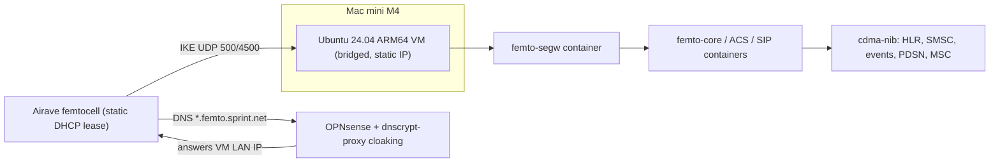

# 1xbts-femtocell

Notes, configs, and scripts for running [1xBTS](https://1xbts.org/docs/) with an old
Sprint Airave femtocell. This is a findings repo: the
[official femtocell guide](https://1xbts.org/docs/guides/femtocells/) assumes a generic
Linux host and LAN, and these docs fill in the parts specific to this setup:

- **Host:** Mac mini M4 (Apple Silicon) running VirtualBox
- **Guest:** Ubuntu Server 24.04 **ARM64** VM, bridged onto the LAN
- **Router:** OPNsense, with **dnscrypt-proxy** answering DNS for LAN clients
- **Radio:** Sprint Airave 2.5 femtocell (Airvana FC330A, firmware 5.x, 1xBTS profile `airave-25-5x`)

## Topology

The femtocell and the Mac mini are on the same LAN. The femtocell asks OPNsense for its
security gateway (`segw*.femto.sprint.net`). dnscrypt-proxy cloaking answers with the VM's
LAN address, so the IPsec tunnel terminates in the `femto-segw` container in the VM.
Everything after that (provisioning, SIP, voice, data) runs inside the tunnel.

## Guide

Follow these in order:

1. [VM setup](docs/01-vm-setup.md): VirtualBox ARM64 guest, bridged NIC, static IP, Docker, Rust, kernel modules
2. [OPNsense DNS](docs/02-opnsense-dns.md): dnscrypt-proxy cloaking, static lease, DNS redirect
3. [Femtocell discovery](docs/03-femto-discovery.md): identify model and firmware, pick a profile, gather credentials
4. [1xBTS bring-up](docs/04-1xbts-bringup.md): build, start the femto stack and core, check the dashboard
5. [Packet data](docs/05-packet-data.md): PDSN A11/A12, capabilities, EV-DO, and the MMS stack
6. [TLS-stripping proxy](docs/06-tls-strip.md) (optional): plain HTTP and mail for handsets, verified TLS upstream

Also see:

- [Findings](docs/findings.md): dated log of gotchas
- [Troubleshooting](docs/troubleshooting.md): symptom-to-check table for this stack

## Repo layout

| Path | Purpose |
| --- | --- |
| `docs/` | Step-by-step guide, findings, troubleshooting |
| `config/*.local.example.json` | Templates for the 1xBTS `config/*.local.json` overrides (placeholders only) |
| `config/tls-strip.local.example.env` | Template for the TLS-strip proxy's mail upstreams and options |
| `docker/tls-strip/` | TLS-stripping proxy: compose project, mitmproxy addon and tests, stunnel mail, rules container, end-to-end test |
| `opnsense/dnscrypt-cloaking.txt` | Cloaking rule to paste into OPNsense |
| `scripts/preflight.sh` | Read-only checks in the VM before starting anything |
| `scripts/start-core.sh`, `scripts/stop-core.sh` | Start and stop the `cdma-nib` core in the right order |
| `scripts/gen-secrets.sh` | Generate the A11 key and A12 secret into a private file |
| `scripts/tls-strip.sh` | Bring the TLS-strip proxy up or down in `fou-nat`'s namespace and check its status |
| `scripts/remote.sh` | Run commands on the Mac mini host using `.env` (see `.env.example`) |
| `vm/create-vm.sh`, `vm/cloud-init/` | Build the VM headlessly from the Ubuntu ARM64 cloud image |
| `vm/provision-guest.sh` | Install packages, Docker, Rust, and kernel modules in the guest |
| `vm/launchd/` | LaunchAgent that starts the VM at host login |

## Secrets

Real credentials (FEID, ACS, SIP, IKE group key, EAP, A11/A12 keys) go only in
`*.local.json` and `*.local.env` files and `secrets/`, all of which are gitignored. The example files
contain placeholders such as `${FEMTO_SIP_PASSWORD}`. Don't commit packet captures or
logs either, since they can contain handset identities and credentials.

## Status

- [x] VM built and bridged (`1xbts`, 192.168.1.50, provisioned)
- [x] DNS cloaking verified on the LAN (OPNsense dnscrypt-proxy Overrides)
- [x] Femtocell static lease (192.168.1.201) and network-wide DNS redirect
- [x] Femtocell seen sending IKE to the VM (IKEv2, ~4.5 min after power-on)
- [x] Femtocell model and firmware identified (Airvana FC330A, firmware 5.x; profile `airave-25-5x`)
- [x] FEID confirmed (= MAC) via SeGW identity probe
- [x] IKE group key validated (global Airave 2.5 constant)
- [x] Device credentials obtained (all six; recovered via radio-module root)
- [x] 1xBTS femto profile and `cdma-nib` build on ARM64
- [x] IPsec tunnel up
- [x] ACS provisioned, SIP registered
- [x] GPS lock, timing synchronized, 1x carrier on air (sector power +6 dBm, 1x + EV-DO)
- [x] Handset registered on air; 1xBTS welcome SMS delivered
- [x] Subscriber provisioned in the HLR (Palm Treo 700w)
- [x] Two-way voice call placed
- [x] Packet core up: 1x + EV-DO bearers on air fault-free, PDSN healthy
- [x] Data attach and browsing confirmed from the handset
- [x] Mbuni MMS stack built and running on ARM64 (`mms` profile)
- [x] TLS-stripping proxy running in `fou-nat`'s namespace (end-to-end test passes with simulated handset traffic)
- [ ] Browse through the TLS-strip proxy from a real handset, and set up Treo mail via `10.55.0.1`
- [ ] Mobile-terminated SMS delivery to the provisioned subscriber
- [ ] Send and receive a test MMS end to end
- [ ] Confirm data uses EV-DO rather than falling back to 1x speeds (to investigate)
