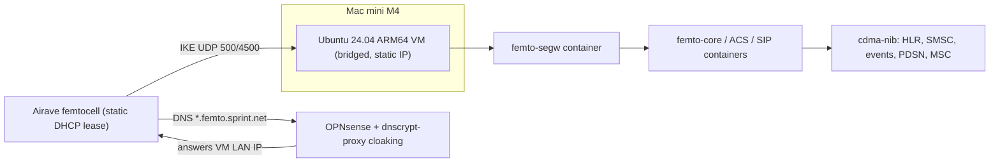

# 1xbts-femtocell

Notes, configs, and scripts for running [1xBTS](https://1xbts.org/docs/) with an old
Sprint Airave femtocell. This is a findings repo: the
[official femtocell guide](https://1xbts.org/docs/guides/femtocells/) assumes a generic
Linux host and LAN, and these docs fill in the parts specific to this setup:

- **Host:** Mac mini M4 (Apple Silicon) running VirtualBox
- **Guest:** Ubuntu Server 24.04 **ARM64** VM, bridged onto the LAN
- **Router:** OPNsense, with **dnscrypt-proxy** answering DNS for LAN clients
- **Radio:** Sprint Airave femtocell (model and firmware still to be identified)

## Topology

The femtocell and the Mac mini are on the same LAN. The femtocell asks OPNsense for its
security gateway (`segw*.femto.sprint.net`). dnscrypt-proxy cloaking answers with the VM's
LAN address, so the IPsec tunnel terminates in the `femto-segw` container in the VM.
Everything after that (provisioning, SIP, voice, data) runs inside the tunnel.

## Guide

Follow these in order:

1. [VM setup](docs/01-vm-setup.md): VirtualBox ARM64 guest, bridged NIC, static IP, Docker, Rust, kernel modules
2. [OPNsense DNS](docs/02-opnsense-dns.md): dnscrypt-proxy cloaking, static lease, DNS redirect
3. [Femtocell discovery](docs/03-femto-discovery.md): identify model and firmware, pick a profile, gather credentials
4. [1xBTS bring-up](docs/04-1xbts-bringup.md): build, start the femto stack and core, check the dashboard
5. [Packet data](docs/05-packet-data.md): PDSN A11/A12, capabilities, EV-DO

Also see:

- [Findings](docs/findings.md): dated log of gotchas
- [Troubleshooting](docs/troubleshooting.md): symptom-to-check table for this stack

## Repo layout

| Path | Purpose |
| --- | --- |
| `docs/` | Step-by-step guide, findings, troubleshooting |
| `config/*.local.example.json` | Templates for the 1xBTS `config/*.local.json` overrides (placeholders only) |
| `opnsense/dnscrypt-cloaking.txt` | Cloaking rule to paste into OPNsense |
| `scripts/preflight.sh` | Read-only checks in the VM before starting anything |
| `scripts/start-core.sh`, `scripts/stop-core.sh` | Start and stop the `cdma-nib` core in the right order |
| `scripts/gen-secrets.sh` | Generate the A11 key and A12 secret into a private file |

## Secrets

Real credentials (FEID, ACS, SIP, IKE group key, EAP, A11/A12 keys) go only in
`*.local.json` files and `secrets/`, both of which are gitignored. The example files
contain placeholders such as `${FEMTO_SIP_PASSWORD}`. Don't commit packet captures or
logs either, since they can contain handset identities and credentials.

## Status

- [ ] VM built and bridged
- [ ] DNS cloaking verified from the femtocell's LAN segment
- [ ] Femtocell model and firmware identified
- [ ] Device credentials obtained
- [ ] 1xBTS femto profile builds on ARM64
- [ ] IPsec tunnel up
- [ ] ACS provisioned, SIP registered
- [ ] GPS lock, radio enabled
- [ ] First handset registration, call, SMS
- [ ] Packet data
