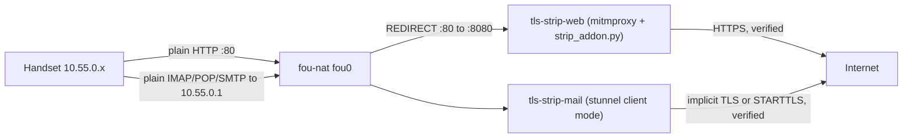

# 6. TLS-stripping proxy (optional)

Do this after packet data works (docs/05). Everything runs in the VM.

The handsets' TLS stacks and root stores are too old for almost every site today, so any
`https://` connection they make fails. This proxy keeps them away from TLS entirely:
handsets speak plain HTTP and plaintext mail, and the proxy makes each connection upstream
over modern TLS with full certificate verification. Nothing is installed on the phones.



## 6.1 How it hooks in

`fou-nat` (upstream 1xBTS) owns the handset subnet `10.55.0.0/24` on its `fou0` tunnel, with
the gateway at `10.55.0.1`. The proxy is a separate compose project,
[`docker/tls-strip/compose.yml`](../docker/tls-strip/compose.yml), and does not touch the
1xBTS checkout. Its three containers join `fou-nat`'s network namespace
(`network_mode: container:1xbts-fou-nat`):

| Container | Job |
| --- | --- |
| `1xbts-tls-strip-web` | `mitmdump` in transparent mode on `10.55.0.1:8080` with [`strip_addon.py`](../docker/tls-strip/web/strip_addon.py). Runs as the `mitmproxy` user with no capabilities |
| `1xbts-tls-strip-mail` | stunnel client mode, one plaintext listener on `10.55.0.1` per mail upstream |
| `1xbts-tls-strip-rules` | Installs the iptables rules below on start and removes them on stop. Debian bookworm, so it uses the same iptables-nft (1.8.9) as `fou-nat` |

The rules live in their own chains:

- `nat TLS_STRIP_PRE` (from `PREROUTING -i fou0 -s 10.55.0.0/24`): traffic to `10.55.0.0/24`
  returns untouched, so the gateway's nginx (MMSC, `speed.`) and handset-to-handset traffic
  never go through the proxy. Other TCP 80 is redirected to `:8080`.
- `filter TLS_STRIP_IN` (from `INPUT -d 10.55.0.1 -p tcp`): the proxy and mail ports accept
  connections only from handsets on `fou0` (and loopback). Everything else is dropped.

TCP 443 is not intercepted. A handset that opens `https://` still gets its own TLS error.

## 6.2 What the web proxy does

For each plain-HTTP request to port 80:

1. **Pick the upstream scheme.** The proxy probes the host once (cached for an hour on
   success, 10 minutes on failure). It sends a `HEAD /` over verified TLS on 443 and waits up
   to `STRIP_PROBE_TIMEOUT` (4 s by default) for an HTTP answer.
   - If the host answers, the request goes upstream over HTTPS.
   - If 443 is closed, resets, never answers HTTP, or times out, the request stays on plain
     HTTP.
   - **If the host presents a certificate that fails verification, the request still goes
     over HTTPS and gets mitmproxy's `502 Bad Gateway` page.** The proxy never downgrades
     around a bad certificate.
2. **Rewrite the response.** `https://host` URLs (default port) become `http://host` in
   `Location`, `Content-Location`, `Refresh` and `Link` headers, and in text bodies (HTML,
   CSS, JS, JSON, XML, WML, including JSON-escaped `https:\/\/`). URLs with another explicit
   port are left alone, because only port 80 is redirected. `Set-Cookie` loses its `Secure`
   flag. `Strict-Transport-Security`, `Content-Security-Policy` (the whole header, since its
   `https:` source lists would block the rewritten URLs), `Expect-CT`, `Public-Key-Pins` and
   `Alt-Svc` are dropped. Binary types and bodies over 8 MiB stream through untouched.
3. **Same-origin headers.** For upgraded requests, `Origin` and `Referer` pointing at the
   same host are switched back to `https://`, so server-side CSRF checks still match.

Never upgraded: requests to ports other than 80, private and other non-global IP literals,
single-label names, and anything in `STRIP_PASSTHROUGH_HOSTS`.

The cached result corrects itself in two cases:

- A plain-HTTP fetch that redirects to `https://` on the same host flips the host to HTTPS.
  That stops a rewritten redirect from looping while the negative cache is still valid.
- An upgraded request that fails with no response for any reason other than the certificate
  flips the host to HTTP for the next request. The reload then works for a host that passed
  the probe but drops real requests.

Logging: no per-request lines (`flow_detail=0`), because URLs can carry tokens. The log
shows connection events with host names, probe fallbacks, and upstream errors such as
`Certificate verify failed`.

## 6.3 Configure

```bash
cd ~/1xbts-femtocell
cp config/tls-strip.local.example.env config/tls-strip.local.env
chmod 600 config/tls-strip.local.env
```

| Key | Meaning |
| --- | --- |
| `MAIL_UPSTREAMS` | Comma-separated `LISTEN_PORT=HOST:PORT[/PROTO]`. With no `/PROTO`, the upstream port speaks implicit TLS (993, 995, 465). `/imap`, `/pop3` or `/smtp` means plaintext plus STARTTLS upstream (143, 110, 587). Empty means no mail listeners |
| `STRIP_PASSTHROUGH_HOSTS` | Hosts (and subdomains) always fetched over plain HTTP. Use it for a site whose 443 serves something different from its port 80 |
| `STRIP_PROBE_TIMEOUT` | Seconds to wait for an HTTPS answer before a host stays on HTTP (default 4) |

Example, one IMAP account plus STARTTLS submission:

```bash
MAIL_UPSTREAMS=1143=imap.example.com:993,1587=smtp.example.com:587/smtp
```

The mail entrypoint rejects malformed entries, duplicate ports, and ports already used on
the gateway (53, 80, 1905, 8080, 9200, 9201, 13000, 13002, 17010-17012). Each listener
verifies the upstream chain and host name against the system CA bundle, sends SNI, and
requires TLS 1.2 or later.

## 6.4 Run

```bash
~/1xbts-femtocell/scripts/tls-strip.sh up       # build, (re)create, wait for healthy, print status
~/1xbts-femtocell/scripts/tls-strip.sh status   # exits 1 if anything is off
~/1xbts-femtocell/scripts/tls-strip.sh down     # stop and remove the rules
```

**Rerun `up` after `fou-nat` restarts or is recreated, and after a VM reboot**, just as you
rerun `host-route.sh add` after an SeGW recreate. The proxy containers stay attached to
`fou-nat`'s *old* network namespace until they are re-created. `status` detects this by
comparing container start times, and also checks that the rules are present and every
listener is bound on `10.55.0.1`.

## 6.5 Test

Unit tests (on any machine with [uv](https://docs.astral.sh/uv/)):

```bash
cd docker/tls-strip/web
uv run --python 3.12 --with mitmproxy==12.3.1 --with pytest --with pytest-asyncio pytest -q
```

End to end, in the VM, with no phone needed:

```bash
python3 ~/1xbts-femtocell/docker/tls-strip/e2e_test.py
```

It plays a handset at `10.55.0.250`. FOU-encapsulated packets go straight to `fou-nat`'s
kernel FOU port, enter `fou0` and meet the real redirect, and replies are read off `fou0`.
It checks five things:

- an HTTPS upgrade (`example.com`)
- a plain-HTTP fallback (`httpforever.com`, which refuses TLS handshakes)
- a rewritten `Location` and dropped HSTS (`google.com`)
- refusal of an expired certificate (`expired.badssl.com`)
- the gateway bypass

It also reads each configured mail listener's greeting. Don't use upstream's
`test_fou_tcp_http.py` client for this: `fou-nat`'s TCP relay takes a single client, and that
client is the PDSN, which the test would kick off.

## 6.6 Handset settings

- **Browser:** type and bookmark `http://` URLs. Links on proxied pages are already
  rewritten. Old HTTPS bookmarks fail the way they always did.
- **Mail (Treo 700w Pocket Outlook):** set the incoming and outgoing servers to `10.55.0.1`
  with the listener ports from `MAIL_UPSTREAMS`, and turn **SSL off**. Credentials are the
  account's own. Providers that need OAuth won't work, so use an app password where offered.
- **BlackBerry Bold 9930:** native BlackBerry OS 7 email relies on BIS, which is gone.
  Mail stripping helps only a third-party client that speaks IMAP/POP/SMTP directly.

## 6.7 Limits and accepted risk

- Passwords and page content cross the 1x air link and the tunnel unencrypted. That is the
  cost of not installing a CA on the phones. The listeners are reachable only from handsets
  on `fou0`.
- Anything that starts as `https://` on the handset (typed URLs, apps with hard-coded HTTPS,
  mail with SSL ticked) is not helped.
- The first request to a host with no working HTTPS waits up to `STRIP_PROBE_TIMEOUT` for
  the probe. Later requests use the cached result.
- Body rewriting changes page bytes, so Subresource Integrity hashes no longer match. These
  browsers don't check them.
- Sites that build `https://` URLs in JavaScript at runtime aren't rewritten.
